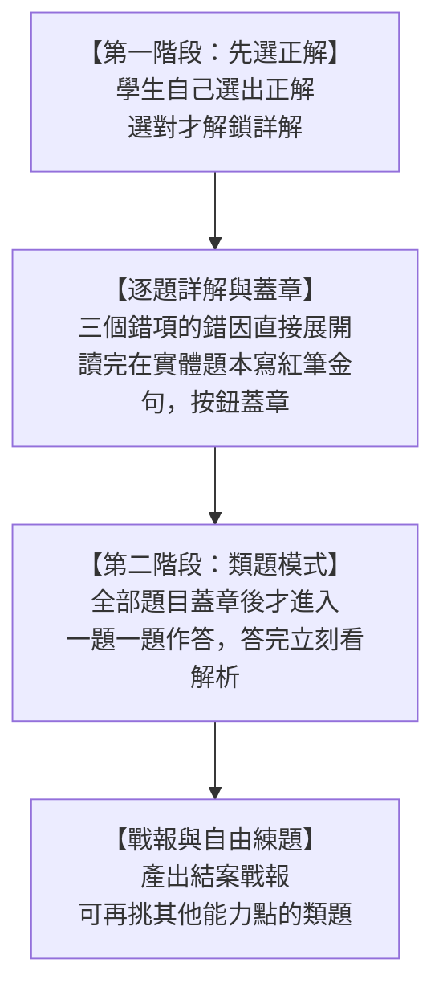

# 考場抓鬼大師：文字找碴審查官與題本硃批手帳（平板完整題庫版）

專為國中現場 **45 分鐘檢討課** 打造的高效自主訂正手帳。

---

## 一、 題幹雙版本：文字版為主，原卷影本隨時切回

為了讓關鍵詞能直接標在句子裡，題幹改以文字版為主，並保留原卷影本對照：

1. **文字版（38 題）**：
   - 從原卷 PDF 文字層抽出，不重新打字，錯字風險低。
   - 可直接選取、用 Ctrl+F 搜尋、用朗讀功能聽讀，老師也能複製貼上做講義。
   - 文言文原文、白話文題組長文、對話框、表格與詩作皆已收錄。
2. **原卷影本（全數保留）**：
   - 每題右上角都有「文字版／原卷影本」切換鈕，學生想看原版排版時隨時切回。
   - 點擊影本可進入全螢幕燈箱，平板手指縮放自如。
3. **保留截圖的 4 題**：
   - 第 2 題（書法字體）、第 14 題（公共自行車 Q&A）、第 17 題（水庫雙圖）、第 34 題（四選項曲線圖）。
   - 這四題的文字本身即為圖像，拆成文字會失去判讀線索，因此維持原寸截圖。
   - 第 20、27、30 題為文字題幹，必要時附上表格或示意圖。

### 行內關鍵詞標注

- **文言文**：字詞直接標在原文，點一下浮現讀音、釋義、白話說明與題本抄寫提示（圈哪個詞、上方寫哪個短義）。
- **文言逐句語譯**：白話翻譯直接接在該句原文下方，不再另設對照區。右上角可一鍵「隱藏語譯」，讓學生先自己讀原文。
- **白話文**：關鍵詞標在文章與選項的原句裡，同一詞最多標兩次，避免整頁畫滿。
- **點詞即查**：點一下標色的詞，說明會直接浮現在詞的旁邊，包含功能標籤與一句話解析；點空白處、按 Esc 或換題即收起，不必再往下找清單。
- **圖片題的替代做法**：無法在原文標注的圖片題，改在圖片下方放一排關鍵詞 chip，點 chip 一樣會浮現說明。
- 詞與詞之間的空白、引號（「」）不影響比對，例如「臺中 65 號」與「臺中65號」視為同一個詞。

---

## 二、 兩階段流程：先看完所有詳解，再進類題模式

1. **第一階段（選正解、看詳解、蓋章）**：四個選項先不標正解，學生自己選。選對才解鎖詳解、題本硃批與蓋章；選錯會抖動提示，詳解不會提前出現。解鎖後，其餘三個錯項下方直接展開「錯在哪個詞、為什麼錯、正確說法」。學生讀完在實體題本寫紅筆金句，按一下蓋章。這一階段沒有類題。
2. **第二階段（類題模式）**：所有勾選題目都蓋章後，先出現一張「詳解完成」預告頁，標示已完成的題數與待做類題數，按「開始類題」才進入。類題一題一題出現，文本或圖表會放在題幹上方；學生作答後立刻看解析，可用「上一題」、「下一題」或「跳過這題」。
3. **最後（戰報與自由練題）**：類題全部做完或跳過後，產出結案戰報。戰報下方可再進入「類題自由練」，挑其他能力點的類題。

### 快速跳題

詳解頁的標題列有一排橫向題號按鈕，目前題號以深色標示，已蓋章題號有綠點。點任何一題就能直接跳過去；題號太多時可左右滑動，按最前面的「全部」會打開完整題號表。

---

## 三、 教師巡堂驗收（3 秒核對）

- 結算戰報直接整理出全清單（題號、官方正解、題本硃批金句）。
- 老師巡堂時，只要看學生螢幕上的金句清單，對照學生紙本題本上的紅筆痕跡，**3 秒鐘就能確認該題到底有沒有動筆寫**！
- 支援「一鍵複製完整戰報文字」，便於學生張貼至 Google Classroom 或作業繳交區。

---

## 四、 文言逐句語譯與點詞即查

文言文的原文卡片直接以「一句原文、一句白話」呈現，白話翻譯就接在該句下方，不再另設對照區。右上角有「隱藏語譯／顯示語譯」開關，預設顯示；老師要學生先自己讀原文時，可以一鍵遮住。

### 文言文 15 題（第 8、13、15、16、19、20、21、22、23、24、38～42 題）

1. **逐句語譯**：每一句原文下方緊接白話翻譯，讀到哪裡就看到哪裡，不必在兩個區塊之間來回找。
2. **字詞隨點隨查**：重要字詞直接標在原文，點一下浮現讀音、釋義與白話說明，不再另設字詞卡。
3. **題本抄寫提示**：浮動卡會多一行「圈哪個詞、上方寫哪個短義」，例如點「銜」會顯示「圈『銜』，上方寫『懷恨』」，保留實體題本的抄寫。
4. **第 20 題另有年齡密碼小抄**：而立 30、不惑 40、知命 50、耳順 60，直接對應選項判讀。

### 白話文 23 題（有文字版者）

不給全文翻譯，改標 **3 至 5 個關鍵詞＋功能標籤**，共 95 條。標籤包含定義句、轉折、舉例、結論、關鍵比喻、數字陷阱等，並用一句話說明「這個詞在文章裡的作用」，避免學生養成等翻譯的依賴。

關鍵詞直接標在文章與選項裡，**點一下就浮現說明**，不再另設一個列表區。少數概念型關鍵詞（例如「相似的經歷」）在原文沒有逐字出現，系統會以最接近的原句作為點擊位置，說明仍照原意呈現。

### 白話文圖片題 3 題（第 2、14、17 題）

這三題的題幹本身是圖片，無法在原文標注，因此改在圖片下方放一排關鍵詞 chip，點 chip 一樣會浮現說明。第 34 題雖為圖表題，但關鍵詞已能在選項與選文中標出，因此不另列 chip。

### 快速入口

題號清單新增「只選文言文（15 題）」快捷鍵，老師可直接帶一節語譯課。

### 資料維護

- 語譯與關鍵詞獨立放在 `assets/data-translation.js`，與題庫介面分離。日後換考卷，只要換這支檔案，不必動 `index.html`。
- 題幹與題組選文的文字版放在 `assets/data-text.js`，以區塊型別（段落、引文、表格、圖片、對話、並排）描述版面。
- 同一個題組共用一篇選文時，以賦值方式指向同一份資料，避免重複維護。

---

## 五、 類題庫與自由練題

42 題都有一題類題。全部詳解與蓋章完成後，系統才進入類題模式，學生一題一題作答，答完立刻看解析。

- 類題模式可用「上一題」、「下一題」與「跳過這題」。
- 全部類題做完或跳過後，才產出戰報。
- 戰報會列出類題完成數、答對數與跳過數。

- 單題類題換新材料，例如第 5 題考字形，類題用四個成語考常見錯字。
- 題組類題沿用同一篇選文，出新問法，不另外貼一篇長文。
- 文言類題沿用同一段原文，考另一個字義、代詞或文意。
- 圖表類題沿用題幹的圖表，出新問法。

### 類題上方會重現文本

類題如果需要文本，文本會直接放在類題題幹上方，學生不必往上捲去找。

- 單題引用原句者，上方重現該段文字。
- 題組與文言題，上方重現整篇選文，並保留標題。
- 圖表題，上方重現原圖。
- 文言類題只顯示原文，不顯示逐句語譯，避免直接給答案。

### 自由練題

戰報頁下方有「類題自由練」。按下後會切換到獨立頁面，不是小視窗。學生做完自己的錯題後，可以：

- 依能力點篩選類題。
- 直接點選想練的題目。
- 按「隨機一題」抽一題。
- 答完後立刻看正解與該選項的解析，並可「再練一題」。
- 按「回戰報」回到結案頁。

### 類題的品質原則

- 單一正解，沒有爭議。
- 誘答選項對應常見迷思，不是隨便湊字。
- 難度與原題相近，不刻意刁難。
- 解析要說出判斷依據，不只說「因為答案是某個選項」。
- 文言類題用真實文本，不自行創作文言。
- 圖表類題沿用原圖，不另外用文字描述圖。

### 資料維護

類題獨立放在 `assets/data-drill.js`，共 42 題。`textFrom` 表示類題上方要重現的文本來源題號，`imageFrom` 表示要重現的圖表來源題號。新增類題時，只要補上這兩個欄位，畫面會自動帶出文本或圖表。

---

## 六、 檔案開啟方式與課堂投影

- **互動程式路徑**：`100_Todo/projects/vibe-coding/exam-detective/index.html`
- **線上發布網址**：`https://sshorng.github.io/exam-detective/`
- **課堂投影掃碼**：頂部導覽列設有「📱 投影學生 QR Code」按鈕。老師投影於教室大螢幕時，點擊即可開啟高對比、大尺寸的學生掃碼登入彈窗，無論本機或線上開啟皆能智慧引導學生連線；支援一鍵複製網址與按 Esc 關閉。
- **使用方式**：滑鼠點兩下直接在 Chrome、Edge 或平板瀏覽器中全螢幕開啟，離線亦可正常運作。

---

## 七、 教師檢討畫筆（隱藏入口，筆跡只存本機）

檢討課時，老師可以直接在畫面上圈關鍵詞、劃掉錯項、在題幹旁寫板書。筆跡只寫進老師自己這臺裝置的瀏覽器本機儲存，不上傳、不同步給學生，也不會出現在學生端畫面。

### 開啟方式（不放在畫面上，避免學生誤觸）

1. 先登入教師身分（錯題熱點 → 密碼），再點一下頁首的「教師模式」標籤。
2. 或在鍵盤按 `Ctrl + Alt + P`，再按一次即收起。

開啟後會出現提示「教師檢討畫筆已啟用・筆跡只留在本機」，螢幕下方同時出現畫筆工具列。

### 工具列功能

- 筆、螢光筆、橡皮擦（整筆擦除）。
- 四色：硃紅、墨黑、青碧、藤黃；粗細：細、中、粗。
- 模式切換：畫筆模式與游標模式可隨時互換，不必收筆。
- 復原（`Ctrl + Z`）、清除本頁、收筆（`Esc`）。
- 快捷鍵：`B` 畫筆、`H` 螢光筆、`E` 橡皮擦、`V` 切換畫筆與游標模式。
- 觸控筆有壓感時，線條粗細會隨力道變化。

### 畫筆模式與游標模式

工具列有「畫筆模式」與「游標模式」兩個按鈕，開啟畫筆後可隨時互換，不必收筆。

- **畫筆模式**：畫布攔截滑鼠、手指與觸控筆，直接在畫面上圈畫。
- **游標模式**：畫布讓開，可直接點選項、按蓋章、切換上一題或下一題、捲動頁面與選取文字。已畫的筆跡仍留在畫面上，切回畫筆模式可繼續寫。
- 按 `V` 或直接點工具列按鈕即可切換。

### 筆跡存在哪裡

- 儲存鍵為 `exam-detective:ink:v2:<頁面識別碼>`，存在瀏覽器 localStorage。同一臺機器開不同考卷的網頁時，筆跡各自獨立，不會互相污染；舊版 `v1` 資料會在第一次開啟時自動搬過來。
- 筆畫以整筆一次成路徑的方式繪製，螢光筆自我交疊不會加深。
- 依情境分開存：清單頁、每題的文字版與原卷影本、類題、自由練、戰報各自一層，換題會自動換回該題自己的筆跡。
- 筆跡座標以整份文件為基準，捲動時筆跡跟著內容移動。
- 最多保留最近 80 個情境，超過時自動淘汰最舊的。
- 換裝置、換瀏覽器、使用無痕模式或清除網站資料後，筆跡不會保留。
- 同一題若在書寫後才展開詳解，版面變長可能讓筆跡與文字位置略微偏移，按「清除本頁」重畫即可。

---

## 八、 錯題熱點硃批榜（教師端，需密碼）

學生按下「展開神探卷宗」時，會在背景把本次勾選的題號送到 Google 試算表。畫面不提示也不阻塞，操作感受與原本一致。

### 學生端

- 錯題登記台的「偵探考生姓名」改為「班級」（例：904），座號保留且同樣必填。
- 按下展開卷宗後資料在背景送出。斷網時先暫存在本機，下次開頁自動補送。
- 送出內容只有班級、座號、題號與一組隨機客戶端碼，不含姓名，也不含作答選項。
- 班級加座號可以對應到個人，屬個資，發放前請向學生說明用途。

### 教師端

- 頁首「錯題熱點」按鈕，首次需教師密碼。密碼存在試算表「設定」工作表的 B1，前端不保存明文。
- 登入一次會記住這臺裝置（權杖存本機，期限 90 天），統計頁有「登出」可隨時撤銷。
- 硃批榜依回報人數排序，前三名加底色；點題號直接跳到該題檢討。
- 點題號進入的是教師檢討模式：不必填班級座號、不必先選正解，詳解與錯項分析直接解鎖。頁面上方是一排題號按鈕（依回報人數排序，目前題高亮），每顆右側有回報人數圓點，顏色越深代表越多人錯；點一下即可換題，最右側是「回錯題熱點」。
- 錯題登記台那 42 格題號也一樣：教師模式下點格子就直接跳到該題，不再只是勾選；清單上方會註明「點題號直接進入該題」。
- 可依班級篩選、可手動更新；工具列右側有 44 像素的試算表圖示按鈕，另開新分頁進入回報試算表（網址由後端回報並驗證來源，取不到時顯示說明）。

### 清空三層

| 層級 | 動作 | 適用時機 |
|:---|:---|:---|
| 第一層 | 清空本考卷目前資料，先歸檔到「歷史」 | 換班級，最常用 |
| 第二層 | 連同本考卷歷史一起清 | 題庫改版 |
| 第三層 | 清空全部回報資料，先歸檔，需輸入「確定清空」 | 學期末 |

### 部署

見 `backend/README.md`，四步即可。取得 `/exec` 網址後填進 `index.html` 的 `Hotspot.GAS_URL`，未填時統計頁會提示尚未接上後端。

### 教師模式的檢討鈕

教師模式下，頁面下方的紅色大鈕不是蓋章，而是「檢討完畢」。按下去只會平滑滑回頁首（題號列在那裡），不會寫入任何學生蓋章狀態；學生端的按鈕文字與行為維持原本的「紅筆硃批・點此蓋章結案」。

---

## 九、 進度版・墨龜賽跑（教師投影用）

學生每蓋一章，背景就送出「已完成／應完成」；老師登入後，頂部導覽列「錯題熱點」旁會出現「進度版」按鈕，按下去投影墨龜跑道看進度。看板右上可切換班級（全部或單一班級，選項會附該班百分比），未登入時這顆按鈕不會出現。

- **全班百分比**：所有學生已完成題數除以應完成題數，大字顯示。
- **每人一條跑道**：座號固定在左側、所有跑道共用同一條起跑線，跑道長度就是該生的完成度（完成轉墨綠、進行中硃紅、0% 停在起跑點）。只列實際有回報的座號，依數字由小到大排序，可以跳號；沒有任何資料時顯示提示文字。
- **里程碑**：25、50、75、100 各有硃紅印章，跨過時墨龜跳一下並播放短音效（可靜音）。
- **更新頻率**：每 10 秒自動更新，離開此頁或分頁隱藏即暫停；可手動按更新。
- **投影大字**：一鍵放大跑道與百分比，適合教室後排。
- **資料表**：「進度」工作表，以考卷加班級加座號為鍵，每人只留最新一列。
